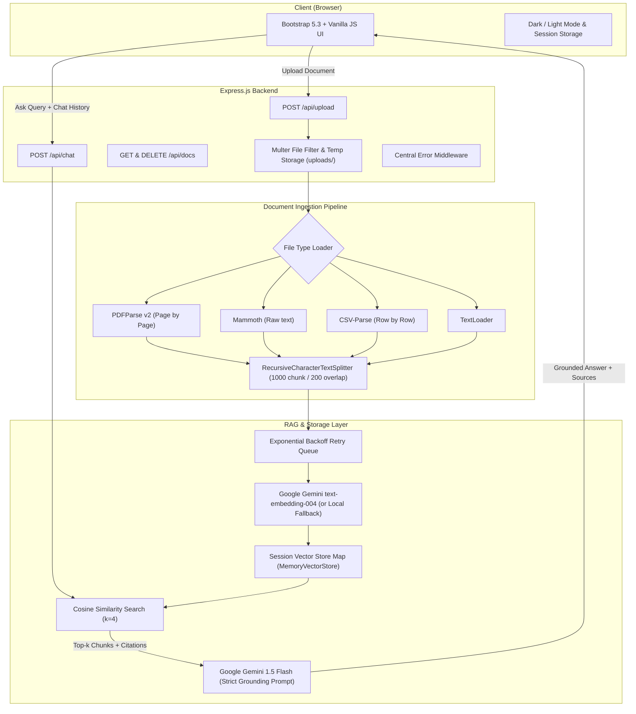

<<<<<<< HEAD
# DoucuMind - RAG Document Chatbot

DoucuMind is a high-performance, 100% free-tier RAG (Retrieval-Augmented Generation) document chatbot built with **Node.js, Express, LangChain.js, and Google Gemini**. It enables users to upload multi-format documents (PDF, DOCX, CSV, TXT) and interactively query them with strict, hallucination-free answers backed by exact source citations and page numbers.

---

## 🏗️ Architecture



---

## ⚡ Tech Stack (100% Free Tier)

| Component | Technology | Description |
|---|---|---|
| **Backend** | Node.js (ESM) + Express 5 | High performance REST API and file handling |
| **Ingestion** | Multer | Whitelisted file uploads up to 10MB; auto-cleanup of temp files |
| **Document Loaders** | `pdf-parse` v2, `mammoth`, `csv-parse` | Page-level PDF extraction, DOCX parsing, CSV row indexing, TXT parsing |
| **Chunking** | `@langchain/textsplitters` | `RecursiveCharacterTextSplitter` (1000 characters, 200 overlap) |
| **Vector Store** | In-Memory Vector Store | Cosine similarity vector search with isolated per-session support |
| **Embeddings** | `@langchain/google-genai` | Google `text-embedding-004` (Free) with offline keyless fallback |
| **LLM** | Google Gemini 1.5 Flash | Fast, high-context free tier model for grounded reasoning |
| **Frontend** | Bootstrap 5.3 + Vanilla JS | Responsive offcanvas sidebar, collapsible source accordions, dark/light theme |

---

## 🚀 Getting Started

### 1. Prerequisites
- **Node.js** v18+ (tested on Node.js v24)
- A free **Google Gemini API Key** from [Google AI Studio](https://aistudio.google.com/)

### 2. Installation
Clone or navigate to the project directory:
```bash
cd DoucuMind
npm install
```

### 3. Environment Configuration
Create or edit your `.env` file in the root directory:
```env
PORT=3000

# Your Google Gemini API Key from https://aistudio.google.com/
GOOGLE_API_KEY=your_actual_gemini_api_key_here

# LLM Model (Free tier)
GEMINI_MODEL=gemini-1.5-flash

# Embeddings Model
GEMINI_EMBEDDING_MODEL=text-embedding-004
```

> **Note:** If `GOOGLE_API_KEY` is not provided, DoucuMind falls back to a deterministic local keyless vectorizer and extracts matching excerpts directly for queries so you can inspect retrieved document chunks offline!

### 4. Run the Application
Start the server:
```bash
npm start
```
Or run in development watch mode:
```bash
npm run dev
```

Open your browser at:
```
http://localhost:3000
```

---

## 🧪 Verification & Testing
Run the automated pipeline test suite to verify file parsing, chunking, memory vector stores, similarity searches, and RAG retrieval:
```bash
node src/utils/test-pipeline.js
```

---

## 📡 API Reference

### 1. `POST /api/upload`
Uploads and indexes a document.
- **Headers:** `x-session-id` (optional, for session isolation)
- **Body:** `multipart/form-data` with field `file` (`.pdf`, `.docx`, `.csv`, `.txt`, max 10 MB)
- **Response:**
  ```json
  {
    "success": true,
    "filename": "quarterly-report.pdf",
    "chunkCount": 14,
    "totalDocuments": 1,
    "totalChunks": 14,
    "message": "Successfully processed \"quarterly-report.pdf\" into 14 chunks."
  }
  ```

### 2. `POST /api/chat`
Submits a query to the RAG pipeline.
- **Headers:** `x-session-id` (optional)
- **Body:**
  ```json
  {
    "query": "What were the total sales in Q3?",
    "history": [
      { "role": "user", "content": "Hello" },
      { "role": "assistant", "content": "Hi! Ask me anything about your documents." }
    ]
  }
  ```
- **Response:**
  ```json
  {
    "success": true,
    "answer": "According to the financial breakdown on page 4, total sales in Q3 reached $14.2M.",
    "sources": [
      {
        "file": "quarterly-report.pdf",
        "page": 4,
        "snippet": "In the third quarter of 2024, our revenue reached $14.2M representing a 12% YoY growth...",
        "score": 0.8924
      }
    ]
  }
  ```

### 3. `GET /api/docs`
Returns all indexed documents and chunk statistics in the active session.

### 4. `DELETE /api/docs/:filename`
Removes a specific document and its associated vector chunks from the memory store.

### 5. `DELETE /api/docs`
Clears all indexed documents from the active session.

### 6. `GET /api/status`
Healthcheck endpoint returning server status, API key status, and active model names.

---

## 🛡️ Key Gotchas & Implementation Details

1. **MemoryVectorStore Volatility:**
   The `MemoryVectorStore` is stored in RAM and is reset when the Node.js server restarts. This ensures zero database setup or external cloud dependencies.
2. **Gemini Free Tier Rate Limits:**
   Gemini's free tier has requests-per-minute limits. DoucuMind includes an exponential backoff retry handler (`src/utils/retry.js`) and batches embedding requests (15 chunks per batch) to prevent dropped requests.
3. **Scanned / Image-Only PDFs:**
   Scanned PDFs without an embedded text layer yield zero text characters. DoucuMind detects empty text extractions and returns an explicit, user-friendly 400 error rather than silently indexing empty chunks.
4. **Session Isolation:**
   Each client receives a unique session ID (`x-session-id`) stored in browser storage. Separate browser sessions have independent memory stores without cross-talk.
5. **Temp File Cleanup:**
   Multer temporarily writes files to `uploads/`. After indexing succeeds or fails, the temporary file is deleted in a `finally` block to prevent disk clutter.
=======
# DocuMind
>>>>>>> 9443aece57c39b24e9bdae8c91d0e75777a52379
